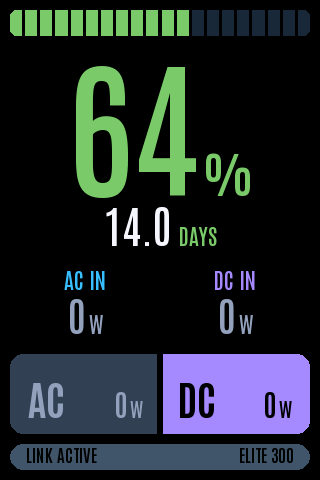
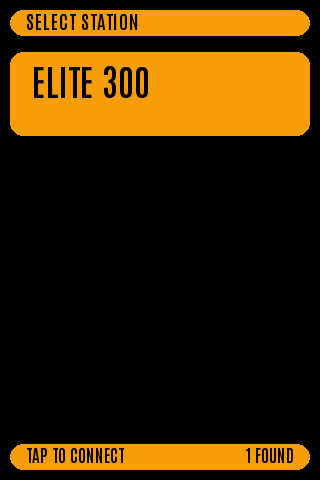

# bluetti-esp32-controller

A small touch screen that sits next to a BLUETTI power station and shows what it's doing at a glance: charge, time remaining, power in and out. Tap to switch the AC inverter on or off. It talks to the station directly over Bluetooth LE, so it needs no app, phone, or Wi-Fi.

<p align="center">
  
  &nbsp;&nbsp;&nbsp;
  
</p>

> Unofficial project, not affiliated with or endorsed by BLUETTI.

## What it shows

- **Charge**: a big percentage plus a segmented bar along the top. The colour runs from rose through amber to green as the battery fills.
- **Time remaining**: as the station reports it, in minutes, hours or days.
- **AC in / DC in**: input power in watts.
- **AC / DC outputs**: each button is lit when that output is on and shows its draw.
- **Link status**: a pill along the bottom with the station's name. It turns amber or red when the link drops or a command fails.

The station is polled every 5 seconds. On each new reading a faint highlight sweeps the charge bar: left to right while charging, right to left otherwise.

## Using it

| Action | What happens |
| --- | --- |
| Tap **AC** | Turns the AC inverter on or off. The button lights as soon as your finger lands and flips on release; the station confirms in the background. |
| Swipe anywhere | Opens the station picker. Holding a finger still does nothing. |
| Tap a station in the picker | Connects to it and remembers it across restarts. |
| **BOOT** button | Same as a swipe: opens the picker. |

DC switching is deliberately left out, because the controller is meant to be powered from the station's own DC output.

**Screen dimming:** while AC is on the screen stays lit. With AC off it fades out after 30 seconds without a touch. A touch on the dark screen only fades it back in; it isn't treated as a tap.

If only one station is in range it connects automatically. With several in range and none saved, the picker opens.

## Hardware

- [Waveshare ESP32-S3-Touch-LCD-3.5](https://www.waveshare.com/wiki/ESP32-S3-Touch-LCD-3.5) (the SPI version): ESP32-S3R8, 16 MB flash, 8 MB PSRAM, 320×480 ST7796 IPS panel, FT6336 capacitive touch.
- A USB-C cable, plugged into the station's USB or DC output for permanent power.

### Supported stations

| Station | Status |
| --- | --- |
| Elite 300 | Tested |
| Handsfree 1 | Tested |

Other stations that use BLUETTI's newer encrypted protocol (V2 registers) will probably work; reports welcome.

## Building

Uses [PlatformIO](https://platformio.org/).

```bash
pio run -t upload
```

Then open the serial monitor at 115200 baud to watch it scan, connect and poll:

```bash
pio device monitor
```

### Serial debug commands

Send these single characters over the serial monitor:

| Command | Effect |
| --- | --- |
| `S` | Dump the screen as raw RGB565 (this is how the screenshots above were made) |
| `D` | Drop the Bluetooth link |
| `P042` | Preview a charge level (here 42%) until the next poll |
| `B` | Press BOOT |
| `X100080` | Tap at x=100, y=080 |
| `W` | Swipe |
| `F` | Forget the saved station and reboot |

## How it works

- **Bluetooth:** [NimBLE-Arduino](https://github.com/h2zero/NimBLE-Arduino). The station advertises as e.g. `EL300<serial>`. Newer BLUETTI firmware encrypts the link: an ECDH key exchange signed with keys from the official app, then AES on every message (`src/bluetti_crypto.cpp`). After that it's Modbus-style register reads and writes; register 2011 switches the AC inverter.
- **Display:** [LovyanGFX](https://github.com/lovyan03/LovyanGFX), drawing into a PSRAM sprite and pushing it to the panel. Small updates (the charge-bar sweep, the pressed AC button) push only their own strip of the screen.
- **Touch:** the FT6336's interrupt line goes to an I/O expander rather than a GPIO, so a small task polls it and turns touches into tap, hold and swipe events.
- **UI:** an LCARS-inspired layout in `src/ui.inc`. The fonts in `src/fonts.h` are [Antonio](https://fonts.google.com/specimen/Antonio) (SIL Open Font License, see `fonts/`), rendered to anti-aliased bitmaps with `tools/make_vlw.py`. `tools/mock_rect.py` renders a PNG mockup of the layout without the hardware.

## Project layout

```
src/
  main.cpp            BLE scanning, connection, polling, input, screen fading
  bluetti_crypto.*    BLUETTI's encrypted handshake and message framing
  display.h           panel, backlight and reset wiring for the Waveshare board
  touch.h             FT6336 polling and gesture detection
  ui.inc              screens, colours, layout
  fonts.h             generated font data
tools/
  make_vlw.py         TTF → smooth-font bitmaps for src/fonts.h
  mock_rect.py        desktop mockup of the UI
fonts/                Antonio and its licence
docs/                 screenshots
```

## Credits

The protocol work builds on the BLUETTI community's reverse-engineering of the station's Bluetooth protocol.

## License

MIT, see [LICENSE](LICENSE). The Antonio font is under the SIL Open Font License, see [fonts/OFL-Antonio.txt](fonts/OFL-Antonio.txt).
